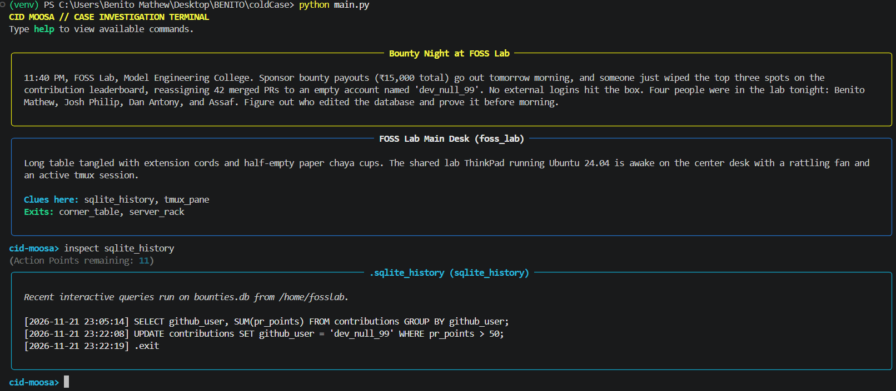
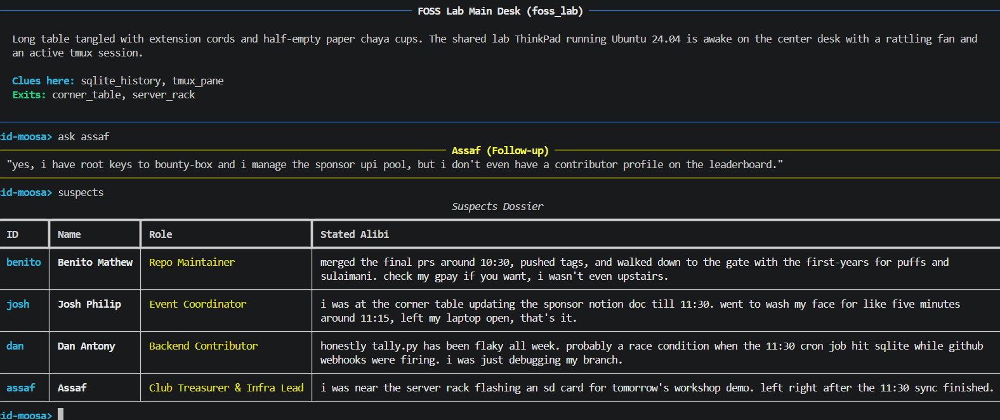

# CIDmoosa — FOSS Lab Investigation Terminal

A terminal-based crime scene investigation game built in Python with [`rich`](https://github.com/Textualize/rich).

Set late at night inside the **FOSS Lab at Government Model Engineering College (MEC)**, the game drops you into a last-minute campus crisis: sponsor bounty payouts (₹15,000 total) go out in the morning, and someone just wiped the top three spots on the contribution leaderboard, reassigning 42 merged PRs to an empty burner account. No external logins hit the server—meaning one of the four people in the lab tonight tampered with the database manually.

Your goal is to explore the lab, examine system logs and physical traces, cross-check suspect alibis, and build an airtight case before morning arrives.

---

## Controls & How to Play

At the `cid-moosa>` prompt, type a command and press **Enter**. Commands are case-insensitive, and rooms, clues, and suspects always use short lowercase IDs (e.g., `corner_table`, `sqlite_history`, `dan`).

### Movement & Observation (Free — 0 AP)

- **`look`** — See what is in your current room, which clues are visible, and where you can go next.
- **`go <room_id>`** — Walk to a connected area (`foss_lab`, `corner_table`, `server_rack`).
- **`suspects`** — Open the dossier table showing all 4 suspects, their roles, and their initial alibis.
- **`notes`** — Check all clues you have collected so far and how many Action Points you have left.
- **`brief`** — Re-read the opening case summary.

### Investigation & Interrogation (1 AP Each)

- **`inspect <clue_id>`** — Examine a log or physical item and save it to your `notes` _(re-reading an already collected clue is free)_.
- **`ask <suspect_id>`** — Press a suspect for a follow-up statement beyond their cover story.
- **`ask <suspect_id> <clue_id>`** — Confront a suspect with a specific clue from your `notes` to test their alibi.

### Ending the Case

- **`accuse`** — Make your final accusation. You must name the true culprit **and** already have the mandatory forensic proof saved in your `notes` to win.
- **`help` / `exit`** — Show commands or quit the game.

---

## Features & Design Choices

Rather than putting everything into a single script full of nested conditionals, I structured **CIDmoosa** as a modular, data-driven CLI engine:

- **Data-Driven Case Schema (`case_data.json`):** Rooms, exits, forensic artifacts, suspect alibis, and evidence-specific interrogation reactions are decoupled from the Python code. New mystery cases can be added by swapping out the JSON file without touching the engine.
- **Clean Separation of Concerns:**
  - `main.py` — Runs the interactive REPL loop and parses commands using Python's built-in `shlex` module so quoted or multi-word arguments are tokenized cleanly.
  - `engine.py` — Manages mutable investigation state (`current_room`, `collected_clues`, `action_points`), room navigation, interrogation logic, and final accusation validation.
  - `ui.py` — Isolates all `rich` terminal formatting (`Panel` and `Table` components) away from core game rules.
- **Action Point Economy & Evidence-Backed Deduction:** Players start with **12 Action Points** per session. Inspecting new evidence or questioning suspects costs 1 AP (re-reading already collected notes is free), preventing brute-force guessing. When making a final accusation, naming the right suspect alone is not enough—the engine verifies that you have actually gathered the mandatory forensic proof to back up your claim.

---

## Project Structure

```text
CIDmoosa/
├── main.py           # Interactive CLI loop & shlex command parser
├── engine.py         # Game state, room movement, AP tracking & accusation rules
├── ui.py             # Rich terminal panels, tables & color formatting
├── case_data.json    # Case story, rooms, artifacts, suspects & solution rules
├── requirements.txt  # Python dependencies (rich)
├── LICENSE           # MIT Open-Source License
└── screenshots/      # Terminal gameplay captures
```

---

## Installation & Setup

### Prerequisites

- Python 3.10 or higher
- Git

### 1. Clone the Repository

```bash
git clone https://github.com/benitomathew/CIDmoosa.git
cd CIDmoosa
```

### 2. Set Up the Virtual Environment

```powershell
# Windows (PowerShell)
python -m venv .venv
.\.venv\Scripts\Activate.ps1
```

```bash
# Linux / macOS
python3 -m venv .venv
source .venv/bin/activate
```

### 3. Install Dependencies

```bash
pip install -r requirements.txt
```

### 4. Run the Game

```bash
python main.py
```

---

## Screenshots

| :-----------------------------------: | :------------------------------------: |
|  |  |

 (screenshots/3.png) | (screenshots/4.png)

## Development Process & AI Usage Disclosure

I built **CIDmoosa** step-by-step across feature branches (`feat/cli-loop`, `feat/case-data-and-ui`, `feat/investigation-engine`, `feat/accusation-system`) rather than pushing everything in a single commit, allowing each layer to be tested cleanly before merging into `main`.

In the spirit of transparency, here is how AI tools were used during development:

- I used Gemini as a pair-programming guide to plan the modular split across `main.py`, `ui.py`, `engine.py`, and `case_data.json`, learn `shlex` command tokenization, and structure `rich` `Panel` and `Table` layouts.
  AI helped identify early bugs—such as dictionary key typos, indentation issues in clue inspection, and input validation when commands are entered without required arguments.

---

## License

This project is licensed under the **MIT License** — see the [LICENSE](LICENSE) file for details.
